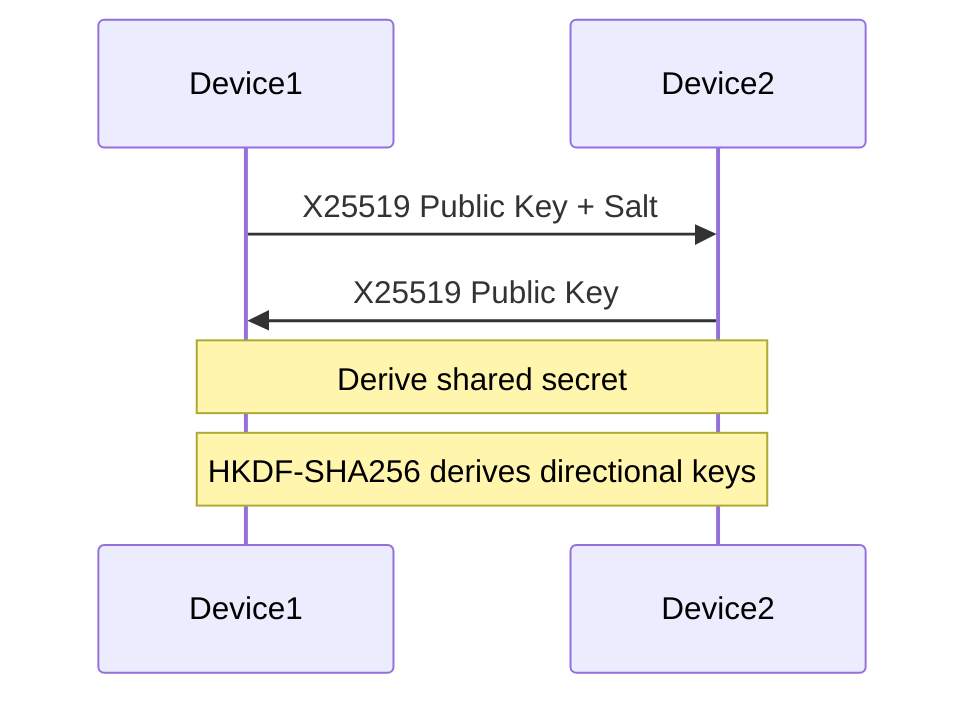
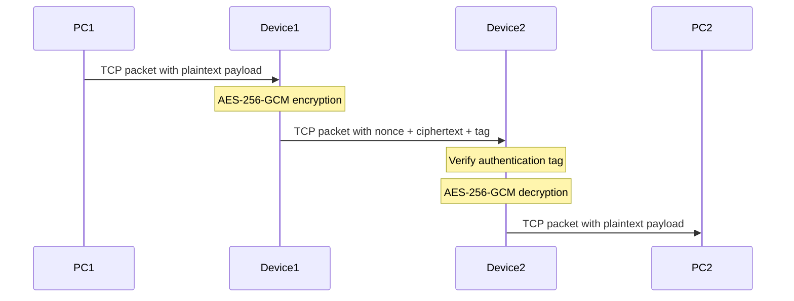

# Transparent Inline TCP Security Gateway (Bump-in-the-Wire)

A Linux-based transparent inline security proxy operating between two network devices (`Device1` and `Device2`). The gateway captures selected TCP/IPv4 traffic, performs key exchange using Diffie–Hellman, encrypts/decrypts TCP payloads in-place using **AES-256-GCM**, recalculates protocol checksums, and forwards modified packets directly without UDP encapsulation or custom tunnel headers.

---

## 🏗 Network Topology

```text
[ PC1 ] <---> (eth0) [ Device 1 ] (eth1) <===[ Encrypted TCP ]===> (eth1) [ Device 2 ] (eth0) <---> [ PC2 ]
```

* **PC1 / PC2**: End-host endpoints communicating via TCP.
* **Device 1 (Encryptor)**: Intercepts outbound TCP traffic, encrypts the TCP payload using AES-256-GCM, appends an authentication tag, recalculates TCP/IP checksums, and forwards the packet.
* **Device 2 (Decryptor)**: Intercepts encrypted packets, verifies the AES-GCM authentication tag, decrypts the payload to plaintext, recalculates checksums, and delivers the original packet to PC2.

---

## 🔐 Key Features & Security Architecture

1. **In-Place Payload Encryption**: Encrypts only the TCP payload of matching traffic. IPv4 and TCP headers remain intact to preserve standard routing behavior.
2. **AES-256-GCM Authenticated Encryption**: Guarantees confidentiality and payload integrity via 128-bit authentication tags.
3. **Unique Nonce Generation**: Employs a unique 96-bit Nonce per encrypted packet within a session, derived via a monotonic sequence counter combined with salt.
4. **Header Checksum Integrity**: Automatically recomputes IPv4 header checksums and TCP pseudo-header checksums after payload modification to prevent packet drop by intermediate routers or end hosts.
5. **Zero-Encapsulation Tunneling**: Operates without wrapping traffic inside IPsec, WireGuard, or UDP encapsulation headers.

---

## 🛠 Prerequisites & Dependencies

Operating system requirement: **Linux (Debian/Ubuntu recommended)**.

Install required dependencies:

```bash
sudo apt-get update
sudo apt-get install -y build-essential libnetfilter-queue-dev libssl-dev iptables
```

---

## 🚀 Build & Execution

### 1. Compilation

Compile the binary using `gcc` or `make`:

```bash
gcc -O2 inline_sec.c -o inline_sec -lnetfilter_queue -lcrypto
```

### 2. Enable IP Forwarding

Enable packet forwarding on both **Device 1** and **Device 2**:

```bash
sudo sysctl -w net.ipv4.ip_forward=1
```

### 3. Set Up NFQUEUE Rules (`iptables`)

Redirect target TCP traffic to `NFQUEUE` (Queue `0`):

**On Device 1 (Encryptor Node):**
```bash
sudo iptables -A FORWARD -p tcp -s <PC1_IP> -d <PC2_IP> -j NFQUEUE --queue-num 0
```

**On Device 2 (Decryptor Node):**
```bash
sudo iptables -A FORWARD -p tcp -s <PC1_IP> -d <PC2_IP> -j NFQUEUE --queue-num 0
```

---

## 🧪 Testing & Verification

1. **Start Security Gateway Applications**:
   * On **Device 1**:
     ```bash
     sudo ./inline_sec 1
     ```
   * On **Device 2**:
     ```bash
     sudo ./inline_sec 2
     ```

2. **Establish Target Traffic**:
   * Start a listener on **PC2**:
     ```bash
     nc -l -p 8080
     ```
   * Connect from **PC1**:
     ```bash
     nc <PC2_IP> 8080
     ```

3. **Observe Gateway Logs**:
   * **Device 1 Output**: `[Device 1] Encrypted packet (12 -> 28 bytes)`
   * **Device 2 Output**: `[Device 2] Decrypted packet (28 -> 12 bytes)`

4. **Packet Inspection**:
   Run `tcpdump` on the link between `Device 1` and `Device 2` to confirm payload bytes are fully encrypted while IP/TCP packet headers remain intact:
   ```bash
   sudo tcpdump -i eth1 -X -nn "tcp port 8080"
   ```

---


## Secure Inline TCP Communication Prototype

### Overview

This project implements a Linux-based prototype for securing TCP payloads
between two inline gateway devices.

Topology:

```text
PC1  -->  Device1  -->  Device2  -->  PC2
            |              |
       Encryption      Decryption
            |              |
       X25519 / AES-256-GCM
```

### Technologies

- C
- OpenSSL 3
- X25519 key exchange
- HKDF-SHA256 key derivation
- AES-256-GCM authenticated encryption
- Linux NFQUEUE
- TCP control channel
- IPv4/TCP packet parsing
- Packet checksum recalculation

### Build

The gateway requires Linux and the NFQUEUE development libraries.

Install dependencies on Debian/Ubuntu:

```bash
sudo apt update
sudo apt install build-essential clang libssl-dev \
    libnetfilter-queue-dev pkg-config iptables
```

Build the project:

```bash
make clean
make test
make gateway
```

### Deployment

Configure Device2 first:

```bash
sudo ./inline_sec 2 9000
```

Configure Device1:

```bash
sudo ./inline_sec 1 <DEVICE2_IP> 9000
```

### NFQUEUE Configuration

On Device1:

```bash
sudo PC1_IP=<PC1_IP> PC2_IP=<PC2_IP> \
    ./scripts/setup-device1.sh
```

On Device2:

```bash
sudo PC1_IP=<PC1_IP> PC2_IP=<PC2_IP> \
    ./scripts/setup-device2.sh
```

Remove the configured rule:

```bash
sudo PC1_IP=<PC1_IP> PC2_IP=<PC2_IP> \
    ./scripts/cleanup-nfqueue.sh
```

### Security Design

1. X25519 is used to derive a shared secret.
2. HKDF-SHA256 derives directional AES keys.
3. AES-256-GCM encrypts and authenticates payloads.
4. Nonces are embedded in each encrypted frame.
5. Authentication failures cause packets to be dropped.

### Limitations

This implementation is a university prototype.

- Peer authentication is not implemented; the handshake is susceptible to MITM attacks.
- TCP sequence and acknowledgment translation requires further development.
- Retransmission, fragmentation, and MTU handling require further hardening.
- The current firewall rules select a limited traffic direction.
- The implementation has not been validated in a complete Linux multi-host deployment.


## Protocol Flow

### Key Exchange



### Payload Encryption



### Frame Format

| Field | Size |
|---|---:|
| Nonce | 12 bytes |
| Ciphertext | Variable |
| Authentication Tag | 16 bytes |

The frame overhead is 28 bytes per encrypted payload.
