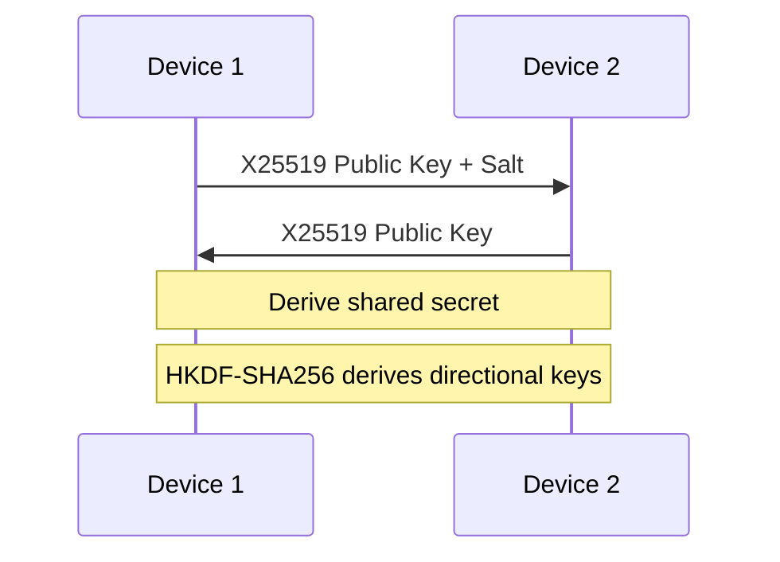
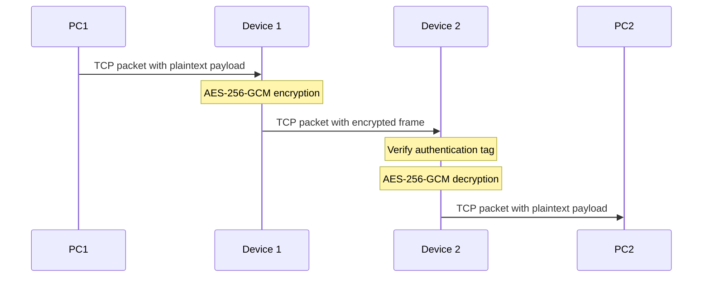

# Transparent Inline TCP Security Gateway

### Bump-in-the-Wire Secure Communication Prototype

A Linux-based inline security gateway prototype designed to protect selected TCP/IPv4 traffic between two end hosts. The system uses X25519 key exchange, HKDF-SHA256 key derivation, and AES-256-GCM authenticated encryption to encrypt and decrypt TCP payloads while preserving IPv4 and TCP headers.

The project is implemented in C using OpenSSL and Linux NFQUEUE.

---

## Network Topology

```text
[ PC1 ] <---> (eth0) [ Device 1 ] (eth1) <== Encrypted TCP ==> (eth1) [ Device 2 ] (eth0) <---> [ PC2 ]
                          |                                          |
                     Encryption                                  Decryption
```

- **PC1 / PC2:** End-hosts communicating over TCP.
- **Device 1 — Encryptor:** Intercepts selected TCP packets, encrypts their payloads, and recalculates packet checksums.
- **Device 2 — Decryptor:** Intercepts encrypted packets, verifies their authentication tags, decrypts payloads, and recalculates checksums.

## Key Features

- **X25519 Key Exchange:** Establishes a shared secret between the gateway devices.
- **HKDF-SHA256:** Derives directional encryption keys from the shared secret.
- **AES-256-GCM:** Provides authenticated encryption and payload integrity.
- **Per-Packet Nonces:** Uses a nonce generated for each encrypted frame.
- **IPv4/TCP Packet Parsing:** Parses selected packets using a modular packet parser.
- **Checksum Recalculation:** Recalculates IPv4 and TCP checksums after packet modification.
- **Linux NFQUEUE Integration:** Captures selected packets using Linux Netfilter.
- **TCP Control Channel:** Provides a separate TCP connection for the cryptographic handshake.
- **Modular C Architecture:** Separates cryptographic, packet-processing, session, framing, and gateway logic.

## Security Architecture

### Key Exchange

The gateways use X25519 to establish a shared secret.

HKDF-SHA256 derives separate directional AES-256 keys using context-specific labels.



### Payload Encryption



### Encrypted Frame Format

Each encrypted frame uses the following format:

| Field              |         Size |
| ------------------ | -----------: |
| Nonce              |     12 bytes |
| Ciphertext         |     Variable |
| Authentication Tag |     16 bytes |
| **Total overhead** | **28 bytes** |

The nonce is transmitted as part of the frame so that the receiving gateway can use the same nonce for authenticated decryption.

## Project Structure

```text
network_hw/
├── include/
│   ├── crypto.h
│   ├── handshake.h
│   ├── session.h
│   ├── frame.h
│   ├── packet.h
│   ├── checksum.h
│   ├── seqmap.h
│   ├── control.h
│   ├── control_socket.h
│   └── gateway.h
│
├── src/
│   ├── crypto.c
│   ├── handshake.c
│   ├── session.c
│   ├── frame.c
│   ├── packet.c
│   ├── checksum.c
│   ├── seqmap.c
│   ├── control.c
│   ├── control_socket.c
│   ├── gateway.c
│   ├── inline_sec.c
│   └── inline_sec_legacy.c
│
├── tests/
│   ├── test_crypto.c
│   ├── test_handshake.c
│   ├── test_session.c
│   ├── test_frame.c
│   ├── test_packet.c
│   ├── test_checksum.c
│   └── test_seqmap.c
│
├── scripts/
│   ├── setup-device1.sh
│   ├── setup-device2.sh
│   └── cleanup-nfqueue.sh
│
├── Makefile
├── .gitignore
└── README.md
```

## Prerequisites

### Operating System

Linux is required for NFQUEUE gateway execution. Debian or Ubuntu is recommended.

### Dependencies

Install the required packages:

```bash
sudo apt update

sudo apt install -y \
    build-essential \
    clang \
    pkg-config \
    libssl-dev \
    libnetfilter-queue-dev \
    iptables
```

## Build

Compile and execute the unit tests:

```bash
make clean
make test
```

Build the gateway executable:

```bash
make gateway
```

The resulting executable is:

```text
inline_sec
```

The unit tests can also be executed individually:

```bash
make test-crypto
make test-handshake
make test-packet
make test-checksum
make test-seqmap
make test-session
make test-frame
```

## Deployment

### 1. Enable IPv4 Forwarding

On both Device 1 and Device 2:

```bash
sudo sysctl -w net.ipv4.ip_forward=1
```

For persistent configuration, enable forwarding in `/etc/sysctl.conf`:

```text
net.ipv4.ip_forward=1
```

Apply the configuration:

```bash
sudo sysctl -p
```

### 2. Start Device 2

Device 2 listens for the control-channel connection:

```bash
sudo ./inline_sec 2 9000
```

### 3. Start Device 1

Device 1 connects to Device 2:

```bash
sudo ./inline_sec 1 <DEVICE2_IP> 9000
```

Replace `<DEVICE2_IP>` with the actual IPv4 address of Device 2.

### 4. Configure NFQUEUE

On Device 1:

```bash
sudo PC1_IP=<PC1_IP> PC2_IP=<PC2_IP> \
    ./scripts/setup-device1.sh
```

On Device 2:

```bash
sudo PC1_IP=<PC1_IP> PC2_IP=<PC2_IP> \
    ./scripts/setup-device2.sh
```

The scripts configure selected TCP traffic to be sent to NFQUEUE queue 0.

### 5. Remove NFQUEUE Rules

On each gateway:

```bash
sudo PC1_IP=<PC1_IP> PC2_IP=<PC2_IP> \
    ./scripts/cleanup-nfqueue.sh
```

## Testing and Verification

### Unit Testing

The project includes unit tests for:

- AES-256-GCM encryption and decryption
- Authentication-tag verification
- X25519 key exchange
- HKDF-SHA256 key derivation
- IPv4/TCP packet parsing
- IPv4 and TCP checksum calculation
- TCP sequence mapping
- Session initialization
- Encrypted frame formatting

Run the complete test suite:

```bash
make test
```

### Traffic Generation

On PC2, start a TCP listener:

```bash
nc -l -p 8080
```

On PC1, connect to PC2:

```bash
nc <PC2_IP> 8080
```

Send test data through the connection.

### Packet Inspection

Capture traffic on the Device 1–Device 2 link:

```bash
sudo tcpdump -i eth1 -X -nn "tcp port 8080"
```

Packet inspection can be used to observe the encrypted payload frames and verify that the gateway modifies packet payloads.

## Security Analysis

### Security Properties

| Mechanism              | Security Purpose                                      |
| ---------------------- | ----------------------------------------------------- |
| X25519                 | Shared-secret establishment                           |
| HKDF-SHA256            | Cryptographic key derivation                          |
| AES-256-GCM            | Payload confidentiality and integrity                 |
| GCM authentication tag | Detection of payload modification                     |
| Per-packet nonce       | Avoidance of nonce reuse within a session             |
| Directional keys       | Separation of transmit and receive cryptographic keys |

### Threat Model

The prototype is intended to demonstrate protection of selected TCP payloads against passive observation and unauthorized payload modification while traffic passes through the inline gateways.

### Known Limitations

This project is an academic prototype and is not a production-ready transparent TCP proxy.

- Gateway peer authentication is not implemented. The X25519 handshake is susceptible to man-in-the-middle attacks.
- TCP sequence-number and acknowledgment-number translation is incomplete.
- Retransmissions and out-of-order TCP segments are not fully handled.
- Full bidirectional TCP flow handling is not yet implemented.
- MTU expansion and fragmentation handling require further development.
- Nonce-counter persistence across session restarts is not implemented.
- Complete multi-host Linux integration testing has not yet been performed.
- IPv4 and TCP headers remain visible and are not encrypted.
- The current implementation does not provide protection for the entire TCP connection lifecycle.

## Future Improvements

- Implement mutual authentication of gateway peers.
- Complete TCP sequence and acknowledgment translation.
- Add robust retransmission and out-of-order packet support.
- Improve bidirectional traffic handling.
- Add MTU-aware packet processing.
- Implement session lifecycle and rekeying.
- Perform end-to-end testing on a Linux multi-host topology.
- Improve logging, error handling, and performance.

## Academic Context

This project was developed as a university networking assignment to demonstrate the implementation of a Linux-based secure inline communication channel using Diffie–Hellman key exchange and AES-GCM authenticated encryption.

The implementation focuses on cryptographic primitives, packet parsing, checksum processing, session management, and NFQUEUE-based packet interception.
